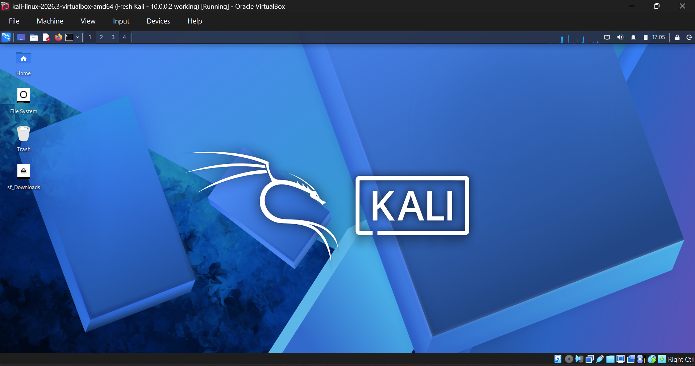
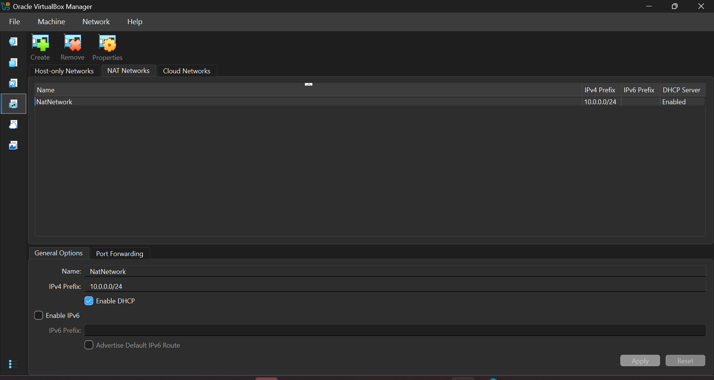
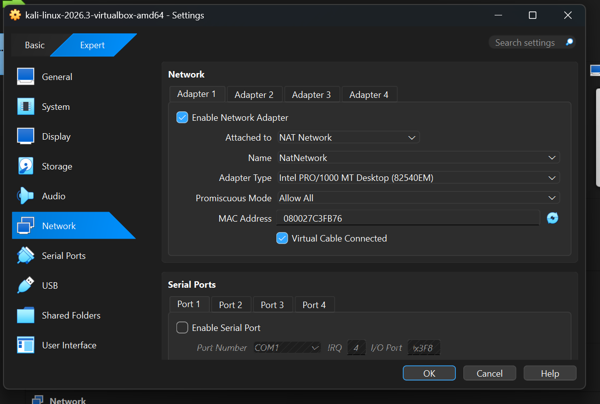
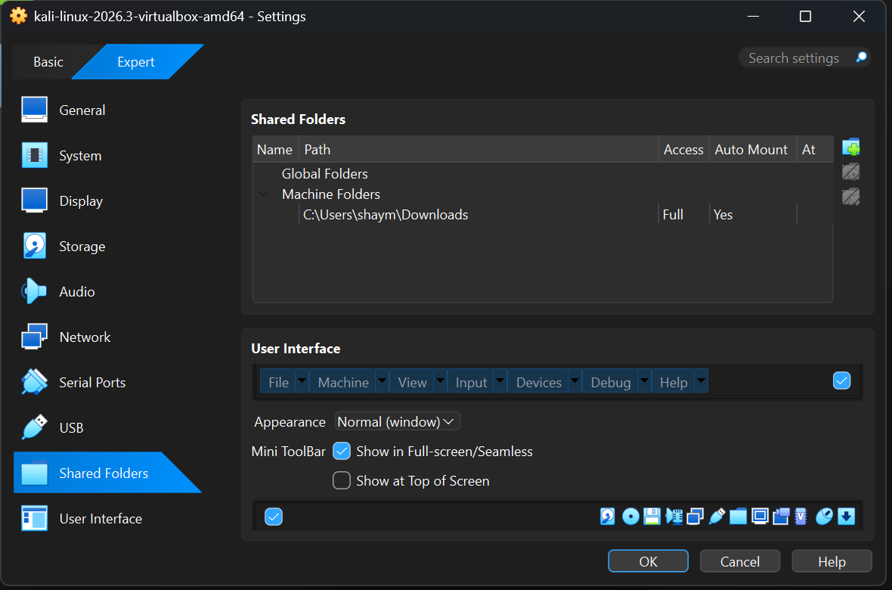
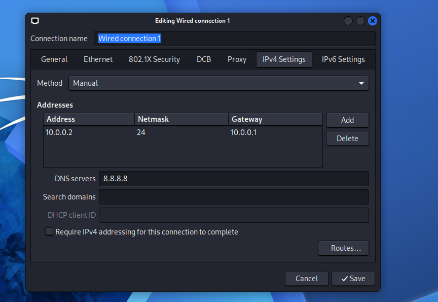
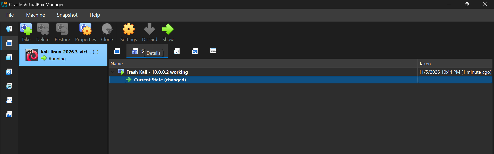
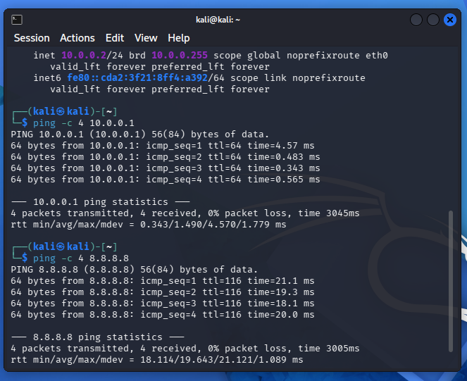
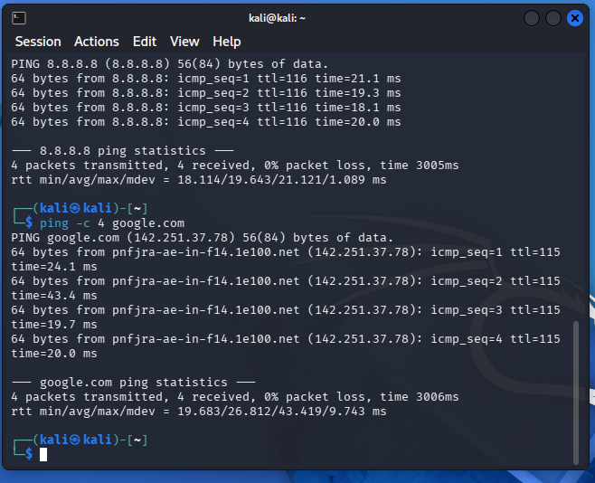

# 🔐 Cybersecurity Lab Setup: VirtualBox + Kali Linux

**My Week 1 project for Networkwalks cybersecurity: a private virtual lab for ethical hacking practice.**

---

## 📌 Project Overview

For Week 1, I built a small cybersecurity lab on my own computer. It runs Kali Linux inside VirtualBox, on a private virtual network. The idea is to have a safe place where I can practice security tools without touching any real systems. More machines can be added to the same network later and used as practice targets.

## 🎯 Objectives

- Install VirtualBox and set up Kali Linux as the attacker machine
- Create a NAT Network on 10.0.0.0/24
- Give Kali a fixed IP address (10.0.0.2/24) and make sure it has full internet access
- Turn on the shared clipboard and drag and drop
- Share my Windows Downloads folder with Kali
- Take a snapshot of the working setup so I can go back to it

## 🏗️ Lab Architecture



The lab has one machine for now: Kali Linux, connected to a VirtualBox NAT Network. Other virtual machines will join the same network in coming weeks.

## ⚙️ Lab Configuration

| Component | Setting |
|---|---|
| Host OS | Windows 11 Home Single Language |
| Host RAM | 8GB |
| Attacker machine | Kali Linux 2026.3 |
| Kali RAM | 2048 |
| Virtual network | NAT Network named `NatNetwork` |
| Network range | 10.0.0.0/24 |
| Kali IP address | 10.0.0.2/24 |
| Gateway | 10.0.0.1 |
| DNS | 8.8.8.8 |

---

## 🪜 Setup Steps

### Step 1. Install 7-Zip
Kali's VirtualBox download comes as a `.7z` file, which Windows can't open on its own, so I installed 7-Zip first.

### Step 2. Install VirtualBox
I downloaded the latest VirtualBox for Windows from virtualbox.org and installed it with the default options.

### Step 3. Create the NAT Network
In VirtualBox, I went to **File > Tools > Network Manager > NAT Networks** and created a new network:

- Name: `NatNetwork`
- IPv4 prefix: `10.0.0.0/24`
- DHCP: enabled
- IPv6: disabled



I used a NAT Network because machines on the same NAT Network can talk to each other and still reach the internet. That is what a lab with several machines needs.

### Step 4. Download and add Kali Linux
I downloaded the pre-built VirtualBox image from kali.org, extracted it to its own folder with 7-Zip, and added the `.vbox` file to VirtualBox. Then I changed the VM settings:

- **Network, Adapter 1:** attached to NAT Network, name `NatNetwork`, promiscuous mode set to Allow All
- **General > Advanced:** shared clipboard and drag and drop, were both set to Bidirectional already.
- **Shared Folders:** my Windows Downloads folder added with Auto-mount on




### Step 5. Set Kali's IP address
Inside Kali, I opened **Edit Connections**, chose **Wired connection 1**, and on the IPv4 tab switched the method to **Manual** with these values:

- Address: 10.0.0.2
- Netmask: 24
- Gateway: 10.0.0.1
- DNS: 8.8.8.8



### Step 6. Take a snapshot
Once everything worked, I took a VirtualBox snapshot called **Fresh Kali - 10.0.0.2 working**. If I break something in a later exercise, I can restore this clean state.



---

## 🔎 Verification

| Check | How I tested it | Result |
|---|---|---|
| IP address | `ip a` | Showed 10.0.0.2/24 |
| Gateway | `ping -c 4 10.0.0.1` | Replies received |
| Internet | `ping -c 4 8.8.8.8` | Replies received |
| DNS | `ping -c 4 google.com` | Replies received |
| Shared folder | Opened `/media/sf_Downloads` in Kali | My Windows files were visible, and files I put there showed up in Windows |
| Clipboard | Copy and paste both ways | Worked |
| Drag and drop | Dragged a file from Windows onto Kali | Worked from Windows to Kali. Dragging out of Kali did not respond, so I use the shared folder to move files out |
| Snapshot | Checked the Snapshots view | Snapshot is saved |




---

## 🐞 Problems I Ran Into and How I Fixed Them

### Problem 1. My first attempt failed and I had to start over
Old files from my first try were still there. VirtualBox was still installed, and the Kali VM showed as "Aborted" and was running from a temporary folder. I think this happened because I opened Kali without extracting the archive properly.

**Fix:** I deleted the VM together with its files, removed the old NAT network, uninstalled VirtualBox, deleted the leftover VirtualBox folders, and restarted the computer. Then I reinstalled everything and extracted the Kali archive to its own folder before opening it.

### Problem 2. The network connection would not turn back on
After setting the static IP, I switched the wired connection off from the network icon and could not switch it back on.

**Fix:** I ran these commands in the terminal, then it reconnected:

```
sudo nmcli connection modify "Wired connection 1" ipv4.dad-timeout 0
sudo nmcli connection up "Wired connection 1"
```

### Problem 3. Drag and drop showed a "not allowed" sign
Even with drag and drop set to Bidirectional, the cursor showed a cancel sign when I dragged a file into Kali. In Task Manager (Details tab, Elevated column) I found VirtualBox was running as administrator. Windows blocks dragging from a normal File Explorer window into an elevated program.

**Fix:** I shut down Kali, restarted the PC, and opened VirtualBox normally from the Start menu, not as administrator. Dragging from Windows into Kali then worked.

### Problem 4. I couldn't type my password in the terminal
When `sudo` asked for a password, nothing appeared on screen. Linux does not show anything while you type a password. I just typed it and pressed Enter.

---

## 💡 What I Learned

- **NAT vs NAT Network:** a NAT Network lets virtual machines reach each other and the internet, which makes it the right choice for a multi-machine lab.
- **Static IP addressing:** I learned what the address, netmask, gateway and DNS each do, and how to check them with `ip a` and `ping`.
- **Snapshots:** take one when the setup is clean, before experimenting.
- **Troubleshooting:** when something fails, check what is actually running (for example, whether a program is elevated) instead of only re-checking settings.
- **Documenting my work:** writing down problems and fixes makes the project easier to repeat and to explain.

## 🔐 Ethical Use

This lab is for learning only. I will only test systems that I own or have clear permission to test.

## 🔗 Tools and Resources

- 7-Zip: https://7-zip.org/download.html
- VirtualBox: https://virtualbox.org/wiki/Downloads
- Kali Linux: https://kali.org/get-kali

## 👤 Author

**Shayma Ashraf,** 
Networkwalks Cybersecurity, Batch B084,
LinkedIn: www.linkedin.com/in/shayma-ashraf-4b1135233

**Program:** Cybersecurity at Networkwalks | **Week:** 1 | **Project:** Cybersecurity Lab Setup (WK1-PM1)
